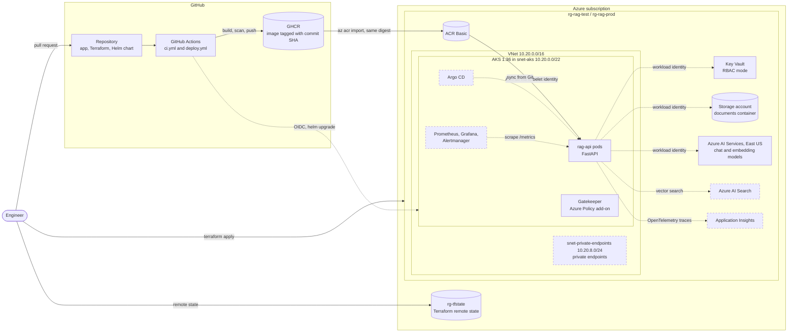
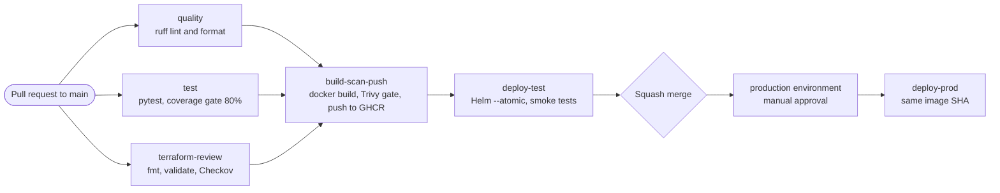
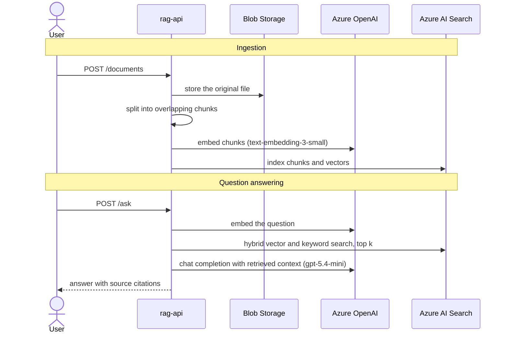

# rag-platform

[](https://github.com/PawanLaksahanOfficial/rag-platform/actions/workflows/ci.yml)
[](https://github.com/PawanLaksahanOfficial/rag-platform/actions/workflows/deploy.yml)


An enterprise style Retrieval Augmented Generation (RAG) platform on Microsoft Azure, built **platform first**: infrastructure as code, a gated software supply chain, Kubernetes delivery and observability come before the AI features, the same way a production team would build it.

> **Project status:** work in progress, built in public. The platform foundations, the CI/CD pipeline and the AKS environment are implemented. Observability, GitOps and the RAG features are on the roadmap. Every capability below is labelled **✅ Implemented** or **🗺️ Planned** so it is always clear what exists today.

## Contents

- [Architecture](#architecture)
- [Capabilities](#capabilities)
- [Tech stack](#tech-stack)
- [Repository structure](#repository-structure)
- [Getting started](#getting-started)
- [Deploying to Azure](#deploying-to-azure)
- [CI/CD pipeline](#cicd-pipeline)
- [Environments](#environments)
- [Security](#security)
- [Observability](#observability)
- [Design decisions](#design-decisions)
- [Known limitations and accepted risks](#known-limitations-and-accepted-risks)
- [Cost management](#cost-management)
- [Roadmap](#roadmap)
- [Author](#author)

## Architecture

### Platform overview

Solid boxes and arrows are implemented. Dashed boxes and arrows are planned.



### Delivery flow



### RAG request flow (🗺️ planned)



The chunking step already exists as the `/chunk` endpoint, and both model deployments are provisioned by Terraform and verified with `scripts/smoke_openai.py`.

## Capabilities

### Application

| Capability | Status |
|---|---|
| FastAPI service with `/health` and `/chunk` endpoints | ✅ Implemented |
| Word based chunking with configurable size and overlap | ✅ Implemented |
| Request validation with Pydantic: text length limits, chunk size limits, `overlap < size`, invalid input returns HTTP 422 | ✅ Implemented |
| Azure OpenAI chat and embeddings smoke test using Entra ID tokens (no API keys) | ✅ Implemented |
| Document ingestion: upload to Blob Storage, chunk, embed, index | 🗺️ Planned |
| Retrieval with Azure AI Search (hybrid vector and keyword search) | 🗺️ Planned |
| `/ask` endpoint returning answers with source citations | 🗺️ Planned |
| Provider interfaces so search (Azure AI Search, Qdrant, pgvector) and LLM (Azure OpenAI, other APIs) are chosen by configuration | 🗺️ Planned |
| LLM evaluation gate in CI (answer quality checked against a test set) | 🗺️ Planned |
| Rate limiting and a daily token budget | 🗺️ Planned |

### Infrastructure as code (Terraform)

| Capability | Status |
|---|---|
| Remote state in Azure Storage with Entra ID authentication, versioning and state locking | ✅ Implemented |
| Separate `test` and `prod` state files and variable files | ✅ Implemented |
| VNet with an AKS subnet and a private endpoint subnet, each with its own NSG | ✅ Implemented |
| Storage account: TLS 1.2, shared keys disabled, no public blobs, versioning, soft delete | ✅ Implemented |
| Key Vault in RBAC mode with soft delete and configurable purge protection | ✅ Implemented |
| Azure AI Services with chat (`gpt-5.4-mini`) and embedding (`text-embedding-3-small`) deployments, local auth disabled | ✅ Implemented |
| AKS cluster and Azure Container Registry | ✅ Implemented |
| Secure by default variables: production settings are the defaults, and test opts out explicitly | ✅ Implemented |
| Least privilege role assignments for every identity | ✅ Implemented |
| Private endpoints and service firewalls ([#8](https://github.com/PawanLaksahanOfficial/rag-platform/issues/8)) | 🗺️ Planned |
| Azure AI Search and Application Insights | 🗺️ Planned |
| Crossplane demo: Azure resources managed from Kubernetes | 🗺️ Planned |

### Kubernetes

| Capability | Status |
|---|---|
| Helm chart with liveness and readiness probes, resource requests and limits | ✅ Implemented |
| Hardened pods: non-root user, no privilege escalation, all Linux capabilities dropped | ✅ Implemented |
| AKS with Microsoft Entra ID authentication and Azure RBAC, local accounts disabled | ✅ Implemented |
| Azure CNI Overlay with the Cilium (eBPF) data plane | ✅ Implemented |
| Image pulls from ACR through the kubelet identity, with no image pull secrets | ✅ Implemented |
| Azure Policy add-on (OPA Gatekeeper) and Key Vault Secrets Store CSI driver | ✅ Implemented |
| Automatic patch upgrades and node image upgrades with a surge limit sized to the vCPU quota | ✅ Implemented |
| Workload identity so pods reach Key Vault, Storage and Azure OpenAI without secrets | 🗺️ Planned |
| Horizontal Pod Autoscaler (template exists, disabled until load testing) | 🗺️ Planned |
| ConfigMaps for configuration, Kubernetes network policies | 🗺️ Planned |
| Argo CD GitOps: CI opens a pull request to bump the image tag, Argo CD syncs and self heals, rollback is a `git revert` | 🗺️ Planned |
| Break and fix drills with runbooks | 🗺️ Planned |

### CI/CD and supply chain security

| Capability | Status |
|---|---|
| Lint and format gate (ruff, including the `S` security rules) | ✅ Implemented |
| Unit and API tests with an 80% branch coverage gate (currently 17 tests, 100% coverage) | ✅ Implemented |
| Terraform `fmt`, `validate` and Checkov as a hard gate, with every skip documented and linked to an issue | ✅ Implemented |
| Docker build with Trivy scanning that blocks fixable HIGH and CRITICAL vulnerabilities | ✅ Implemented |
| Images tagged with the commit SHA and promoted unchanged from test to prod (build once, deploy many) | ✅ Implemented |
| Automated test deployment with Helm `--atomic` rollback and smoke tests, including a negative 422 test | ✅ Implemented |
| Production deployment behind a GitHub environment approval | ✅ Implemented |
| Protected `main` branch: pull requests and passing checks required, no force pushes or deletion | ✅ Implemented |
| Least privilege workflow permissions, third party security actions pinned to commit SHAs | ✅ Implemented |
| GitHub OIDC federated credential to Azure (no stored cloud secrets) and deployment to AKS | 🗺️ Planned |
| Secret scanning, dependency review and SCA | 🗺️ Planned |
| SBOM generation, Cosign image signing and SLSA provenance | 🗺️ Planned |
| Kyverno admission policies (for example, only signed images may run) | 🗺️ Planned |
| DAST with OWASP ZAP against the test deployment | 🗺️ Planned |
| Dependabot or Renovate updates, and base images pinned by digest | 🗺️ Planned |

### Observability and operations

| Capability | Status |
|---|---|
| kube-prometheus-stack on AKS: Prometheus, Grafana, Alertmanager, node exporter, kube-state-metrics | 🗺️ Planned |
| `/metrics` endpoint with RED metrics (rate, errors, duration) and a ServiceMonitor in the Helm chart | 🗺️ Planned |
| Grafana dashboards for the API, pods and nodes | 🗺️ Planned |
| SLO with a multi window burn rate alert | 🗺️ Planned |
| OpenTelemetry traces to Application Insights, with KQL queries and an alert rule | 🗺️ Planned |
| Ops script in PowerShell and Azure CLI, optionally a timer triggered Azure Function | 🗺️ Planned |
| Incident drill with a written postmortem | 🗺️ Planned |
| Portable hosting on OCI Always Free: Terraform for the VMs, Ansible installing k3s, Argo CD, Loki for logs | 🗺️ Planned |

## Tech stack

| Area | Tools |
|---|---|
| Application | Python 3.13, FastAPI, Pydantic v2, Uvicorn |
| Testing and quality | pytest, pytest-cov, HTTPX test client, ruff |
| Containers | Docker multi stage build on `python:3.13-slim`, GitHub Container Registry, Azure Container Registry |
| Infrastructure as code | Terraform (azurerm 4.x), Azure Storage remote backend |
| Azure | AKS, ACR, Virtual Network, NSGs, Key Vault, Storage, Azure AI Services (Azure OpenAI), Microsoft Entra ID, Azure Policy |
| Kubernetes | Helm, Cilium, OPA Gatekeeper, Secrets Store CSI driver, kind (for CI) |
| CI/CD | GitHub Actions, GitHub environments, branch rulesets |
| Security scanning | Checkov, Trivy, ruff security rules |
| Planned | Argo CD, Prometheus, Grafana, Alertmanager, OpenTelemetry, Application Insights, Azure AI Search, Crossplane, Kyverno, Cosign, Syft, OWASP ZAP, Ansible, k3s, Loki |

## Repository structure

```text
rag-platform/
├── app/
│   ├── main.py              # FastAPI app: /health and /chunk with request validation
│   └── chunking.py          # word based chunking with overlap
├── tests/
│   ├── test_api.py          # API tests, including invalid requests returning 422
│   └── test_chunking.py     # chunking unit tests
├── charts/rag-api/          # Helm chart (deployment, service, HPA template, probes)
│   ├── values.yaml
│   └── values-test.yaml     # values used by the pipeline
├── infra/                   # Terraform
│   ├── versions.tf          # providers and remote backend
│   ├── main.tf              # resource group, naming suffix, tags
│   ├── network.tf           # VNet, subnets, NSGs
│   ├── storage.tf           # documents storage account
│   ├── keyvault.tf          # Key Vault and role assignment
│   ├── openai.tf            # Azure AI Services and model deployments
│   ├── aks.tf               # AKS, ACR, identities and role assignments
│   ├── variables.tf
│   ├── output.tf
│   └── envs/                # per environment backend keys and variables
│       ├── test.backend.hcl
│       ├── test.tfvars
│       ├── prod.backend.hcl
│       └── prod.tfvars
├── scripts/
│   └── smoke_openai.py      # calls the chat and embedding deployments with Entra ID auth
├── .github/workflows/
│   ├── ci.yml               # quality, test, terraform-review, build-scan-push, deploy-test
│   └── deploy.yml           # deploy-prod after merge, behind approval
├── Dockerfile
├── pyproject.toml           # pytest, ruff and coverage configuration
├── requirements-app.txt
└── requirements-dev.txt
```

## Getting started

### Prerequisites

- Python 3.13
- Docker
- For Kubernetes: kubectl, Helm and kind
- For Azure: Azure CLI, Terraform 1.9 or later, kubelogin

### Run the API locally

```bash
python -m venv .venv
source .venv/bin/activate          # Windows PowerShell: .venv\Scripts\Activate.ps1
pip install -r requirements-dev.txt
uvicorn app.main:app --reload
```

Open http://localhost:8000/docs for the interactive OpenAPI documentation.

```bash
curl http://localhost:8000/health
# {"status":"ok"}

curl -X POST http://localhost:8000/chunk \
  -H "Content-Type: application/json" \
  -d '{"text": "one two three four five six seven", "size": 4, "overlap": 1}'
# {"count":2,"chunks":["one two three four","four five six seven"]}

curl -i -X POST http://localhost:8000/chunk \
  -H "Content-Type: application/json" \
  -d '{"text": "a b c", "size": 5, "overlap": 5}'
# HTTP/1.1 422 Unprocessable Entity (overlap must be smaller than size)
```

### Run the quality gates

```bash
ruff check .
ruff format --check .
pytest --cov
```

### Run in a container

```bash
docker build -t rag-api:local .
docker run --rm -p 8000:8000 rag-api:local
```

### Run on a local Kubernetes cluster

```bash
kind create cluster --name dev
kind load docker-image rag-api:local --name dev
helm upgrade --install rag-api charts/rag-api -n test --create-namespace \
  -f charts/rag-api/values-test.yaml \
  --set image.repository=rag-api --set image.tag=local
kubectl -n test port-forward svc/rag-api 8080:8000
```

## Deploying to Azure

> The backend in `infra/versions.tf` points at the author's state storage account. To deploy into your own subscription, create a storage account for state and update the `backend "azurerm"` block first.

1. Sign in and set the subscription.

   ```bash
   az login
   ```

   Create `infra/terraform.tfvars` (git ignored):

   ```hcl
   subscription_id = "<your subscription id>"
   ```

2. Plan and apply the test environment.

   ```bash
   terraform -chdir=infra init "-backend-config=envs/test.backend.hcl"
   terraform -chdir=infra plan "-var-file=envs/test.tfvars" -out=tfplan
   terraform -chdir=infra apply tfplan
   ```

   Keep the quotes. Windows PowerShell splits unquoted `-flag=value` arguments at the first dot.

3. Connect to AKS with Entra ID.

   ```bash
   az aks get-credentials --resource-group rg-rag-test --name aks-rag-test
   kubelogin convert-kubeconfig -l azurecli
   kubectl get nodes -o wide
   ```

4. Promote the CI tested image into ACR and deploy it.

   ```bash
   ACR=$(terraform -chdir=infra output -raw acr_name)
   REGISTRY=$(terraform -chdir=infra output -raw acr_login_server)
   TAG=<commit sha built by CI>

   az acr import --name $ACR --source ghcr.io/pawanlaksahanofficial/rag-api:$TAG --image rag-api:$TAG
   helm upgrade --install rag-api charts/rag-api -n test --create-namespace \
     -f charts/rag-api/values-test.yaml \
     --set image.repository=$REGISTRY/rag-api --set image.tag=$TAG \
     --atomic --timeout 5m
   ```

5. Destroy everything at the end of the session.

   ```bash
   terraform -chdir=infra destroy "-var-file=envs/test.tfvars"
   ```

## CI/CD pipeline

Every pull request to `main` runs `ci.yml`. Merging runs `deploy.yml`.

| Job | What it does | Fails the build when |
|---|---|---|
| `quality` | `ruff check` (including security rules) and `ruff format --check` | Lint errors or unformatted code |
| `test` | `pytest --cov` with branch coverage | A test fails or coverage drops below 80% |
| `terraform-review` | `terraform fmt -check`, `init -backend=false`, `validate`, then Checkov | Formatting, invalid configuration, or any Checkov finding that is not fixed or documented |
| `build-scan-push` | `docker build --pull`, Trivy scan, push to GHCR tagged with the commit SHA | Any fixable HIGH or CRITICAL vulnerability |
| `deploy-test` | Creates a kind cluster, deploys with Helm `--atomic`, runs smoke tests | The release does not become healthy, `/health` fails, or an invalid request does not return 422 |
| `deploy-prod` | After merge and manual approval, deploys the **same image SHA** with 3 replicas | The release does not become healthy (Helm rolls back automatically) |

Today both deployment targets are kind clusters created inside the GitHub runner, which proves the promotion flow without paying for always-on clusters. Moving the deploy jobs to AKS with GitHub OIDC is the next planned step.

## Environments

| Setting | test | prod |
|---|---|---|
| Region | South India | Central India |
| AKS tier | Free | Standard (uptime SLA) |
| Key Vault purge protection | Off, so the environment can be destroyed and recreated | On |
| Storage replication | LRS | GRS (paired with South India) |
| Terraform state key | `rag-platform/test.tfstate` | `rag-platform/prod.tfstate` |
| Pipeline target today | kind cluster on the runner | kind cluster on the runner, after approval |
| Provisioned in Azure | On demand, destroyed after each session | Defined in code, not provisioned |

The AI Services account is in East US in both environments because that region has model quota for the subscription. Test runs in South India because the subscription's regional vCPU quota and VM size availability are better there.

## Security

**Identity instead of secrets.** Nothing in this platform uses a shared key or password:

- Storage shared key access is disabled.
- Azure AI Services local (key) auth is disabled.
- The ACR admin user is disabled.
- AKS local accounts are disabled.
- Terraform state is read with Entra ID.

**Least privilege role assignments**

| Identity | Role | Scope | Status |
|---|---|---|---|
| AKS control plane (user assigned identity) | Network Contributor | `snet-aks` only | ✅ |
| AKS kubelet identity | AcrPull | The registry | ✅ |
| Operator | Azure Kubernetes Service RBAC Cluster Admin | The cluster | ✅ |
| Operator | Key Vault Secrets Officer, Storage Blob Data Contributor, Cognitive Services OpenAI User | Each resource | ✅ |
| GitHub Actions (federated credential) | AcrPush, AKS RBAC Writer | Registry, `test` namespace | 🗺️ |
| rag-api pods (workload identity) | Key Vault Secrets User, Storage Blob Data Reader, Cognitive Services OpenAI User | Each resource | 🗺️ |

**Policy as code.** Checkov blocks every pull request with an unhandled finding. Each finding is either:

- fixed,
- made the secure default (with test opting out in `test.tfvars`),
- or skipped inline with a written reason and a link to a tracking issue.

The current result is 47 passed, 0 failed, 23 skipped. Inside the cluster, the Azure Policy add-on runs OPA Gatekeeper, so Kubernetes objects are checked at admission time as well.

**Container hardening.**
- Multi stage build, and the runtime image is patched at build time.
- `pip` is removed from the runtime image.
- The app runs as a non-root user (UID 10001), with all Linux capabilities dropped and privilege escalation blocked.

## Observability

🗺️ Planned. The design:

- **Metrics:** self-hosted kube-prometheus-stack on AKS. The API exposes RED metrics on `/metrics`, and a ServiceMonitor in the Helm chart makes Prometheus scrape it automatically. Grafana is reached through `kubectl port-forward`, so it has no public endpoint.
- **SLO:** for example, 99% of `/chunk` requests succeed over 30 days. A multi window burn rate rule in Alertmanager fires when the error budget is being spent too fast.
- **Traces:** OpenTelemetry instrumentation sends traces to Application Insights, queried with KQL. OpenTelemetry keeps the backend swappable.
- **Autoscaling:** the HPA scale-out under load is shown on the Grafana dashboard.

Azure Managed Prometheus and Azure Managed Grafana were considered. The self-hosted stack was chosen because it is portable to any Kubernetes cluster and adds no cost beyond the existing node.

## Design decisions

| Decision | Why |
|---|---|
| Platform first, RAG features second | A reliable, secure delivery path makes every later feature cheap to ship and easy to roll back |
| Build once, deploy many | The image that passed tests and Trivy is the exact image that reaches production, identified by commit SHA. Promotion to ACR uses `az acr import`, which keeps the same digest |
| Entra ID with Azure RBAC for AKS, local accounts off | Per person, revocable, audited access managed in the same Terraform as everything else. No static admin kubeconfig exists |
| User assigned identity for the AKS control plane | It exists before the cluster, so it can be granted rights on just the AKS subnet before the cluster is created |
| Azure CNI Overlay with Cilium | Pods do not consume VNet addresses, and Cilium's eBPF data plane enforces network policies efficiently |
| Secure defaults, explicit test opt outs | A new environment is production grade unless someone deliberately says otherwise, and Checkov sees the defaults |
| Checkov as a hard gate with documented skips | Accepted risks are visible, reasoned and tracked in issues instead of hidden behind a soft fail |
| One node pool in test | The subscription has a 4 vCPU regional quota. One 2 vCPU node plus a 1 node upgrade surge fits exactly |
| kind clusters in the pipeline today | Proves the promotion flow on every pull request at zero cost. AKS is used for real cloud sessions |
| Self-hosted Prometheus and Grafana | Industry standard, portable to EKS, k3s or on premises, and free on existing capacity |

## Known limitations and accepted risks

These are deliberate, documented trade-offs. Each one is tracked in an issue.

- **Public endpoints with Entra ID only** ([#8](https://github.com/PawanLaksahanOfficial/rag-platform/issues/8)): Storage, Key Vault and AI Services accept public traffic, but every request needs an Entra ID token. Private endpoints and service firewalls are planned. Blob read logging is planned in the same issue.
- **Public AKS API server** ([#10](https://github.com/PawanLaksahanOfficial/rag-platform/issues/10)): there is no authorized IP list because GitHub hosted runners use changing IP addresses. Access still requires Entra ID and Azure RBAC.
- **Basic ACR** ([#10](https://github.com/PawanLaksahanOfficial/rag-platform/issues/10)): private access, quarantine and zone redundancy need the Premium SKU. Trivy in CI covers image scanning.
- **Shared node pool** ([#10](https://github.com/PawanLaksahanOfficial/rag-platform/issues/10)): system and application pods share one pool because of the vCPU quota. Production would add a separate user pool and taint the system pool.
- **No RAG endpoints yet:** ingestion, retrieval and `/ask` are on the roadmap. Today the API serves health and chunking only.

## Cost management

The project runs on an Azure free account, and nothing is left running between sessions.

- The test environment costs about $0.15 per hour while it exists, mostly the single AKS node, the load balancer and the registry.
- Every session ends with `terraform destroy`, which leaves only the Terraform state storage.
- Production is defined in code but never provisioned.
- The AKS Free tier is used in test. Paid add-ons (Container insights, Managed Prometheus, Managed Grafana, Defender) are left off.

## Roadmap

**Platform foundations**
- [x] Terraform remote state with Entra ID authentication
- [x] Network, storage, Key Vault and Azure AI Services in Terraform
- [x] FastAPI service, hardened container image and Helm chart
- [x] CI/CD with quality, test, Terraform review, image scanning, test deploy and approved prod deploy
- [x] Request validation with negative smoke tests
- [x] Checkov as a hard gate with documented accepted risks
- [x] AKS and ACR with Entra ID, Azure RBAC and Cilium

**Kubernetes delivery on AKS**
- [ ] GitHub OIDC federated credential, pipeline deploys to AKS with no stored secrets
- [ ] Workload identity for pods, HPA, ConfigMaps, network policies, break and fix drills
- [ ] Argo CD GitOps with image tag pull requests, self healing and rollback by `git revert`
- [ ] Crossplane demo

**Observability**
- [ ] kube-prometheus-stack, `/metrics`, ServiceMonitor and Grafana dashboards
- [ ] SLO with a burn rate alert
- [ ] OpenTelemetry traces to Application Insights and KQL

**Operations**
- [ ] PowerShell and Azure CLI ops script, optional timer triggered Azure Function
- [ ] Runbooks, incident drill and postmortem
- [ ] v1.0.0 release with screenshots and run evidence

**Supply chain hardening**
- [ ] Secret scanning, dependency review and SCA
- [ ] SBOM, Cosign signing and SLSA provenance
- [ ] Kyverno admission policies and OWASP ZAP
- [ ] Dependabot or Renovate, base images pinned by digest

**RAG features**
- [ ] Document ingestion into Blob Storage with embeddings
- [ ] Azure AI Search index with hybrid retrieval
- [ ] `/ask` with source citations
- [ ] Pluggable search and LLM providers
- [ ] LLM evaluation gate, rate limits and token budget

**Portable hosting**
- [ ] OCI Always Free VMs with Terraform, k3s installed by Ansible, Argo CD
- [ ] Same image and Helm chart, with Prometheus, Grafana and Loki

## Author

**Pawan Laksahan**, Software Engineer
GitHub: [@PawanLaksahanOfficial](https://github.com/PawanLaksahanOfficial)
